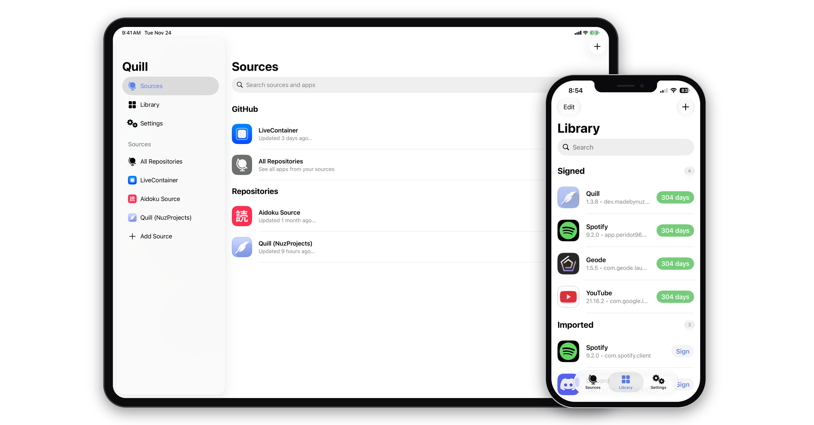

**Quill is a free, open-source IPA signer for iPhone and iPad. Sign and install apps right on your device with your own certificate or a free Apple ID. No computer, no jailbreak, and it updates itself.**

[Website](https://quill.madebynuz.dev) · [Download](#download) · [FAQ](#faq) · [Changelog](../CHANGELOG.md) · [Discussions](https://github.com/NuzProjects/Quill/discussions)

<picture><source media="(prefers-color-scheme: dark)" srcset="demo-dark.png"><source media="(prefers-color-scheme: light)" srcset="demo-light.png"></picture>

## Download

Get the latest `Quill.ipa` from [Releases](https://github.com/NuzProjects/Quill/releases/latest), or add the AltStore source. Once installed, Quill keeps itself up to date from Settings → Updates.

Quill runs on iOS and iPadOS 16 or later.

## Features

**Signing**
- **Sign and install on your device** with a `.p12` and `.mobileprovision` pair, or **sign in with a free Apple ID** and Quill makes the certificate and profiles for you.
- **Get a Certificate** from Settings, from Apple or a trusted provider.
- **Certificate health.** Expiry and revocation alerts, plus days left, capabilities, devices and signed apps at a glance.
- **Safer signing.** Warnings before signing apps that need a newer iOS, are still App Store encrypted, or won't run on this device, with plain-language errors and time estimates.
- **Signing options** to change the name, bundle ID, icon and appearance, add Files app support, patch for Liquid Glass, strip the Apple Watch app and unused languages, and more.
- **Tweaks** for advanced users: inject `.deb` and `.dylib` files using [ElleKit](https://github.com/tealbathingsuit/ellekit).
- **Working extensions.** Widgets and share sheets inside signed apps get their own profile.

**Apps and sources**
- **[AltStore](https://faq.altstore.io/distribute-your-apps/make-a-source#apps) sources and GitHub releases.** Add either and install IPAs straight from them.
- **Search across sources**, see when each app last updated, and get notified when apps in your Library have updates.
- **Import from files, links or a copied `.ipa` link**, find your apps in Spotlight, and sign or check for updates with Siri and Shortcuts.

**Everything else**
- **In-app updates.** Quill downloads, signs and installs its own updates.
- **Live progress.** Signing, downloads and updates show as a floating panel, on the Lock Screen and in the Dynamic Island.
- **Home Screen and Lock Screen widgets** for certificates and your Library.
- **iPad sidebar**, Backup & Transfer, a customizable tab bar, and Developer Logs with one-tap bug reports.
- **13 languages.**
- **No tracking or analytics.** Quill doesn't collect any data.

Widgets and Live Activities need a certificate that covers all app IDs.

## FAQ

<b>Do I need a computer or a jailbreak?</b>

No. Quill signs and installs apps entirely on your iPhone or iPad, on stock iOS.

<b>Do I need a paid developer account?</b>

No. You can sign in with a free Apple ID in Settings → Certificates. Apple's free limits apply: signed apps last 7 days, up to 3 can be installed at once, and up to 10 new apps can be added per week. A paid Apple Developer account ($99 a year) or a certificate from a provider removes those limits.

<b>How is this different from AltStore or Sideloadly?</b>

Those need a computer to sign apps or to refresh them. Quill does the signing on your device, so once it's installed you don't need a computer again. Quill can still read AltStore sources.

<b>My certificate was revoked. What now?</b>

Apps signed with a revoked certificate stop opening. Quill checks for this in the background and notifies you. Import or get a new certificate, then re-sign your apps; Quill shows which apps used the old one.

<b>An app won't install or crashes on launch.</b>

Check that the IPA isn't App Store encrypted, that your device is in the certificate's provisioning profile, and that the app supports your iOS version. Quill warns about all three before signing. If it still fails, open Settings → Misc → Developer Logs and [file a bug report](https://github.com/NuzProjects/Quill/issues/new?template=bug.yml).

<b>How does Quill relate to Feather?</b>

Quill started as a fork of [Feather](https://github.com/claration/Feather) by Samara and keeps its GPL-3.0 license. It adds in-app updates, free Apple ID signing, certificate health, widgets, Live Activities and much more. See the [comparison](https://quill.madebynuz.dev/compare/feather), and the [comparison with ESign](https://quill.madebynuz.dev/compare/esign).

<b>Does Quill collect any data?</b>

No. There's no tracking or analytics. Your certificates and Apple ID details stay on your device, in its Keychain.

## Contributing

Bug reports, ideas, translations and pull requests are all welcome.

- **Found a bug?** [Open a bug report](https://github.com/NuzProjects/Quill/issues/new?template=bug.yml).
- **Have an idea?** [Suggest a feature](https://github.com/NuzProjects/Quill/issues/new?template=feature.yml).
- **Questions or sources to share?** Head to [Discussions](https://github.com/NuzProjects/Quill/discussions).
- **Want to code or translate?** Read the [contributing guide](./CONTRIBUTING.md). It covers building, how the project is laid out, and translations in `Quill/Resources/Localizable.xcstrings`.
- **Security issue?** Please report it privately. See the [security policy](./SECURITY.md).

Curious how signing and installing work under the hood? See [How it works](./HOW_IT_WORKS.md).

## Acknowledgements

- [NuzFlameV2](https://github.com/NuzProjects) - Creator of Quill
- [Samara](https://github.com/claration) - Creator of the original Feather, which Quill is forked from
- [idevice](https://github.com/jkcoxson/idevice) - Backend for builds with this included, used for communication with `installd`.
- [*.backloop.dev](https://backloop.dev/) - localhost with public CA signed SSL certificate
- [Vapor](https://github.com/vapor/vapor) - A server-side Swift HTTP web framework.
- [Zsign](https://github.com/zhlynn/zsign) - Allows signing on-device, re-implemented to work on other platforms such as iOS.
- [LiveContainer](https://github.com/LiveContainer/LiveContainer) - Fixes/some help
- [Nuke](https://github.com/kean/Nuke) - Image caching.
- [Asspp](https://github.com/Lakr233/Asspp) - Some code for setting up the HTTP server.
- [plistserver](https://github.com/nekohaxx/plistserver) - Hosted on https://api.palera.in.

## License

Quill is licensed under GPL-3.0. You can see the full details of the license [here](https://github.com/NuzProjects/Quill/blob/main/LICENSE). It's under this specific license because I wanted to make a project that is transparent to the user thats related to certificate paired sideloading, before this project there weren't any open source projects that filled in this gap.

By contributing to this project, you agree to license your code under the GPL-3.0 license as well (including agreeing to license exceptions), ensuring that your work, like all other contributions, remains freely accessible and open.
